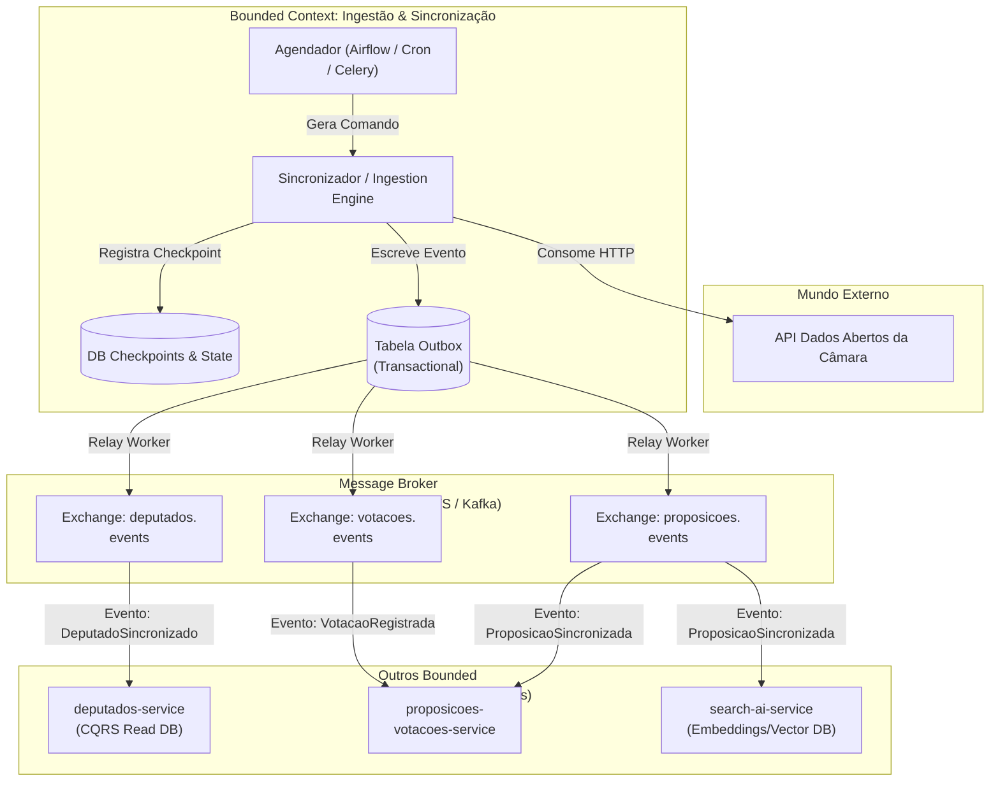

```
  ### 2. Estrutura de Código Recomendada
```

  Abaixo está a estrutura de diretórios em Python
  para o repositório ingestion-service:
```BASH
    ingestion-service/
    ├── config/
    │   └── settings.py              # Variáveis de ambiente (pydantic-settings)
    ├── src/
    │   ├── domain/                  # CAMADA DE DOMÍNIO (Sem dependências externas)
    │   │   ├── aggregates/
    │   │   │   └── sync_job.py      # Agregado que controla o estado de sincronização
    │   │   ├── entities/
    │   │   │   ├── raw_deputado.py  # Entidade interna de validação de dados coletados
    │   │   │   └── raw_proposicao.py
    │   │   ├── value_objects/
    │   │   │   ├── periodo.py       # Data de início/fim da busca
    │   │   │   └── sync_status.py   # Enum: PENDENTE, EM_ANDAMENTO, CONCLUIDO, ERRO
    │   │   ├── events/
    │   │   │   ├── base.py
    │   │   │   ├── deputado_events.py
    │   │   │   └── proposicao_events.py
    │   │   └── ports/               # Interfaces abstratas (Contratos ABC)
    │   │       ├── camara_api_port.py
    │   │       ├── event_publisher_port.py
    │   │       └── sync_repository_port.py
    │   │
    │   ├── application/             # CAMADA DE APLICAÇÃO (Casos de Uso)
    │   │   ├── dtos/                # Data Transfer Objects
    │   │   │   └── sync_commands.py
    │   │   ├── use_cases/
    │   │   │   ├── sincronizar_deputados.py
    │   │   │   ├── sincronizar_proposicoes.py
    │   │   │   └── sincronizar_despesas.py
    │   │   └── services/
    │   │       └── retry_policy.py  # Lógica de Retry / Exponential Backoff
    │   │
    │   ├── infrastructure/          # CAMADA DE INFRAESTRUTURA (Adaptadores concretos)
    │   │   ├── adapters/
    │   │   │   ├── camara_http_client.py  # Consumo da API da Câmara (substitui api_camara.py)
    │   │   │   ├── ollama_summarizer.py   # Resumos via LLM (substitui ollama_resumo_politico.py)
    │   │   │   └── rabbitmq_publisher.py  # Publicação de eventos
    │   │   ├── persistence/
    │   │   │   ├── models.py              # Modelos SQLAlchemy locais (Apenas checkpoints/jobs)
    │   │   │   └── sync_repository.py     # Implementação do SyncRepositoryPort
    │   │   └── logging/
    │   │       └── logger.py
    │   │
    │   └── entrypoints/             # PONTOS DE ENTRADA DO SERVIÇO
    │       ├── cli/
    │       │   └── main.py          # CLI para execução manual ou scripts
    │       ├── jobs/
    │       │   └── runner.py        # Executador chamado pelo Airflow / Cron
    │       └── api/
    │           └── health.py        # Endpoints REST de Healthcheck / Metrics (FastAPI leve)
    │
    ├── tests/
    │   ├── unit/
    │   └── integration/
    ├── Dockerfile.ingestion
    ├── pyproject.toml
    └── README.md
  ──────
```  
  
  ### 3. Exemplos Práticos de Código

  #### A. O Evento de Domínio
  (src/domain/events/deputado_events.py)

  O evento representa o que aconteceu no domínio de
  ingestão para que outros microserviços reajam:
```PYTHON
    from dataclasses import dataclass
    from datetime import datetime

    @dataclass(frozen=True)
    class DeputadoSincronizadoEvent:
        event_id: str
        occurred_on: datetime
        id_camara: int
        nome: str
        sigla_uf: str
        sigla_partido: str
        url_foto: str | None
        email: str | None

        def to_dict(self) -> dict:
            return {
                "event_name": "DeputadoSincronizado",
                "event_id": self.event_id,
                "occurred_on": self.occurred_on.
  isoformat(),
                "data": {
                    "id_camara": self.id_camara,
                    "nome": self.nome,
                    "sigla_uf": self.sigla_uf,
                    "sigla_partido": self.
  sigla_partido,
                    "url_foto": self.url_foto,
                    "email": self.email,
                }
            }
```
  ──────
  #### B. A Porta da API Externa
  (src/domain/ports/camara_api_port.py)

  Interface pura que desacopla o caso de uso de
  bibliotecas como httpx ou requests:

```PYTHON
    from abc import ABC, abstractmethod
    from typing import List
    from src.domain.entities.raw_deputado import
  RawDeputado

    class CamaraApiClientPort(ABC):
        @abstractmethod
        async def fetch_deputados(self, legislatura:
  int) -> List[RawDeputado]:
            """Busca lista bruta de deputados da API
  oficial."""
            pass

        @abstractmethod
        async def fetch_detalhes_deputado(self,
  id_camara: int) -> dict:
            """Busca detalhes específicos de um
  deputado."""
            pass
```
  ──────
  #### C. O Caso de Uso
  (src/application/use_cases/sincronizar_deputados.p
  y)

  Contém a orquestração da sincronização sem saber
  como o banco ou a fila funcionam:

```PYTHON
    import uuid
    from datetime import datetime
    from src.domain.ports.camara_api_port import
  CamaraApiClientPort
    from src.domain.ports.event_publisher_port
  import EventPublisherPort
    from src.domain.ports.sync_repository_port
  import SyncJobRepositoryPort
    from src.domain.events.deputado_events import
  DeputadoSincronizadoEvent

    class SincronizarDeputadosUseCase:
        def __init__(
            self,
            camara_api: CamaraApiClientPort,
            publisher: EventPublisherPort,
            sync_repo: SyncJobRepositoryPort,
        ):
            self.camara_api = camara_api
            self.publisher = publisher
            self.sync_repo = sync_repo

        async def execute(self, legislatura: int) ->
  int:
            # 1. Coleta dados da fonte externa
            deputados_brutos = await self.
  camara_api.fetch_deputados(legislatura)

            processados = 0
            for dep in deputados_brutos:
                # 2. Converte para Evento de Domínio
                event = DeputadoSincronizadoEvent(
                    event_id=str(uuid.uuid4()),
                    occurred_on=datetime.utcnow(),
                    id_camara=dep.id_camara,
                    nome=dep.nome,
                    sigla_uf=dep.sigla_uf,
                    sigla_partido=dep.sigla_partido,
                    url_foto=dep.url_foto,
                    email=dep.email,
                )

                # 3. Publica o evento para o
  barramento (RabbitMQ/Kafka)
                await self.publisher.
  publish("deputados.events", event.to_dict())
                processados += 1

            # 4. Atualiza o checkpoint local de
  execução
            await self.sync_repo.
  save_checkpoint("DEPUTADOS", legislatura,
  processados)
            return processados
```
  ──────
  ### Summary das Vantagens dessa Estrutura

  1. Sem acoplamento com o banco do Frontend: O
  ingestion-service passa a ter apenas o seu banco
  leve de Checkpoints/Control Jobs.
  2. Resiliência: Se a API da Câmara cair, o serviço
  trata o Retry/Exponential Backoff sem travar nada
  do resto do sistema.
  3. Escalabilidade Independente: Você pode rodar a
  ingestão em containers que sobem apenas no horário
  agendado do Airflow e morrem em seguida, reduzindo
  custos de infraestrutura.

Bounded context
só traz aquilo que faz sentido pro negócio, é estrito, por exemplo. No QuemVota "deputado" tem dois sentidos: 1- o injest que traz cpf, nome, etc e a chamada da minha API que traz diversas informações como salario, empresas contratadas, etc.

domains
supporting subdomain -> algo que não é diferencial competitivo no negócio, está apenas ali para prestar suporte.


ACL (anti-corruption-layer)
é um emburrecimento ou filtro para o meu dominio, eu pego somente aquilo que me interessa.

estruturas de pastas:

Adapters -> o mundo exterior, http, bancos, filas, sistemas de arquivos.

data tranfer objects (dtos) -> são estruturas de dados puras, sem regras de negócio

value object -> objeto definido apenas pelo seu atributo (não tem ID proprio), mesmo valor, mesmo objeto

fazer um contrato de entrada, saida, e não misturar os dois pois isso acaba dando em acoplamento (dependencia entre partes do sistema) e vai contra as regras do DDD.